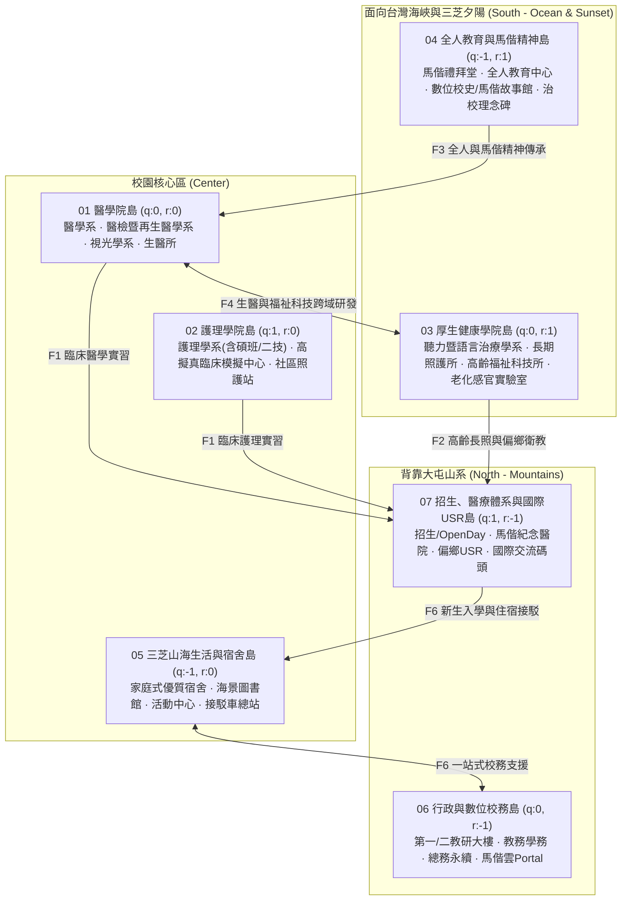

# 馬偕醫學大學官網（`mmu.edu.tw`）「3D 互動校園島」精簡重製專屬規格書
**(Mackay Medical University "3D Interactive Campus Island" Simplified Remake Specification)**

- **文件版本**：v1.0
- **建立日期**：2026-10-23
- **目標網站**：馬偕醫學大學官方網站 (`https://www.mmu.edu.tw/`)
- **參考標竿架構**：`puma.taipei/heart-island`（HEART 政策島）精簡化適配版
- **專案產出位置**：
  - 互動網站原型：[index.html](./index.html)
  - 規格書雙格式：`MMU_REMAKE_SPEC.md` & `MMU_REMAKE_SPEC.html`

---

## 1. 現有網站 (`mmu.edu.tw`) 診斷與重製目標

### 1.1 現況痛點分析
1. **視覺與空間感扁平**：現行首頁由傳統大圖輪播（Swiper）、三欄文字新聞列表、兩排六欄圖片磚（常用連結）與 20 個快速連結按鈕構成，難以在第一時間傳遞馬偕醫學大學位於新北市三芝區**「依山面海（背靠大屯山系、面向台灣海峽與夕陽）」**的立體校園魅力。
2. **跨域關聯性隱沒**：學校擁有極具特色的 **「三大院系（醫學、護理、厚生健康）× 馬偕紀念醫院臨床體系 × 偏鄉 USR 衛教服務 × 國際醫療實習」** 生態圈，但在傳統選單中各自獨立，訪客與考生不易看見系所與未來臨床／社會實踐的連結。
3. **校園導覽體驗靜態**：現有「校園導覽圖」僅為靜態 JPG 平面圖列表，缺乏互動探索樂趣。
4. **合規優勢需延續**：現有網站已通過數位發展部 **AA 等級無障礙網頁檢測**，重製版必須在導入 3D 視覺的同時，100% 保留語意化結構、鍵盤操作與無障礙檢索能力。

### 1.2 精簡重製設計決策（經 `/grill-me` 訪談確認）

| 決策維度 | 核定方案 | 相較原版 (`heart-island`) 之精簡效益 |
| :--- | :--- | :--- |
| **1. 網站定位與島嶼規模** | **7 座核心六角島綜合入口架構**（涵蓋 3 大學院、全人/馬偕精神、山海校園生活、行政/數位校務、招生/醫院實習/USR，共 27 座微縮建築） | 由 14 島 94 建築濃縮為 **7 島 27 建築**，建模與資料維護成本降低 **70%**，視覺焦點更集中。 |
| **2. 3D 動態與特效範圍** | 保留 **「三芝山海地形 + 四段光影切換」**、**「6 條跨島連結光管」**、**「Q 版師生與彩蛋角色（馬偕博士）巡迴」** | 移除高達 108KB 的複雜紙娃娃試衣間 (`heart-me.js`)、分幀 Raycast 與城市日誌 LIVE 事件流，程式碼精簡 **55%**。 |
| **3. 篩選與時段控制區** | 底部改為 **「四大受眾身分導覽（全校總覽／考生與家長／在校學生／教職員與校友）」**；頂部設 **「清晨／白天／三芝夕陽／星空」** 按鈕 | 移除複雜的 24 小時拉桿與任期時間軸，直接解決大學官網最重要的「受眾分流與常用系統快速跳轉」需求。 |
| **4. 資訊整合與版面配置** | 滿版 `100dvh` 3D 互動舞台 + 右側面板 **「三頁籤（校園島嶼導覽 ／ 最新消息與公告 ／ 常用系統入口）」** + 左上角 **「焦點快訊膠囊」** | 完美收納原首頁 4 大類最新消息與 20+ 個校務連結（Portal、Moodle、圖書館、電子公文），畫面不擁擠。 |

---

## 2. 七大核心六邊形島嶼與 27 座微縮地標規格 (Hexagonal Islands Layout)

採用尖頂六邊形（Pointy-top Hexagon）蜂巢狀七島佈局（1 座中心島 + 6 座環繞島），拼合成馬偕三芝山海學園：

### 各島詳細建築與原始官網連結映射表

| 島嶼編號與名稱 | 六角座標 `(q, r)` | 地面材質 | 微縮建築地標（共 27 座） | 對應 `mmu.edu.tw` 真實網址與功能 |
| :--- | :---: | :---: | :--- | :--- |
| **01 醫學院島** College of Medicine | `(0, 0)` | 花崗岩廣場 `granite` | ① **醫學系暨臨床醫學館** ② **醫學檢驗暨再生醫學中心** ③ **視光學系視覺科學館** ④ **生物醫學研究所** | `medicine.mmu.edu.tw` `lab-reg-med.mmu.edu.tw` `optometry.mmu.edu.tw` `biomedical.mmu.edu.tw` |
| **02 護理學院島** College of Nursing | `(1, 0)` | 柔光暖墊 `softpad` | ① **護理學系大樓（學士／碩士／二技）** ② **高擬真臨床技能模擬中心 (OSCE)** ③ **社區健康與長者照護實作站** | `nursing.mmu.edu.tw` `cnursing.mmu.edu.tw` |
| **03 厚生健康學院島** Health & Welfare | `(0, 1)` | 療癒草坪 `garden` | ① **聽力暨語言治療學系館** ② **長期照護研究所** ③ **高齡福祉科技研究所** ④ **老化感官體驗實驗室** | `aud-slp.mmu.edu.tw` `ltc.mmu.edu.tw` `gw-tech-sci.mmu.edu.tw` 高齡健康產業博覽會參展亮點 |
| **04 全人與馬偕精神島** MacKay Spirit | `(-1, 1)` | 紅磚人文庭院 `terracotta` | ① **馬偕精神禮拜堂（焚而不燬）** ② **全人教育中心** ③ **數位校史館暨馬偕故事館** ④ **治校理念與董事會紀念碑** | `holistic.mmu.edu.tw` `zone.mmu.edu.tw/MMCHistory/` 摩西／馬偕／馬偕醫院／我們的故事 `mmuboard.mmu.edu.tw` |
| **05 山海生活與宿舍島** Campus Life | `(-1, 0)` | 校園跑道綠地 `schoolyard` | ① **家庭式優質學生宿舍** ② **圖書館暨馬偕共學園** ③ **多功能活動中心與運動場** ④ **三芝校園交通接駁總站** | 家庭式宿舍專頁、`lib.mmu.edu.tw`、`sharelearning.mmu.edu.tw`、交通路線與公車時刻表 |
| **06 行政與數位校務島** Administration | `(0, -1)` | 現代石板大道 `street` | ① **第一、二教研行政大樓（校長／秘書／研發）** ② **教務與學生事務中心（含校安專線）** ③ **總務與永續校園中心（CSR／法規／財務）** ④ **數位校務雲端中樞（Portal／Moodle／公文）** | `academic.mmu.edu.tw`、`studentaffairs.mmu.edu.tw`、`general.mmu.edu.tw`、`research.mmu.edu.tw`、`portal.mmu.edu.tw`、`moodle.mmu.edu.tw` |
| **07 招生、醫療與國際USR島** Admissions & USR | `(1, -1)` | 海濱木棧道 `boardwalk` | ① **招生資訊中心暨 OPEN DAY 廣場** ② **馬偕紀念醫院臨床實習基地** ③ **USR 偏鄉衛教與 SDGs 永續基地** ④ **國際醫療交流碼頭（台蒙／台美交流）** | `admissions.mmu.edu.tw`、`zone.mmu.edu.tw/freshmen/`、`mmh.org.tw`、`mmuusr.mmu.edu.tw`、`sprout.mmu.edu.tw` |

---

## 3. 跨島協作流（Flows）與彩蛋角色規格

### 3.1 六條跨島動態協作線 (`flows`)
1. **`F1` 臨床實習與醫療連結線**：`01 醫學院` + `02 護理學院` ➔ `07 馬偕紀念醫院臨床基地`（Q 版醫護學生手持「聽診器與病歷」前往馬偕紀念醫院、彰基、新樓等教學醫院實習）。
2. **`F2` 高齡長照與偏鄉 USR 服務線**：`03 厚生健康學院` ➔ `07 USR 偏鄉衛教基地`（Q 版師生手持「視力與骨密檢測箱」前往三芝、台東、恆春、烏來進行社區衛教與兒童品格營）。
3. **`F3` 馬偕精神與全人博雅教育線**：`04 全人與馬偕精神島` ➔ `01 醫學院`、`02 護理學院`、`03 厚生健康學院`（將「寧願燒盡，不願銹壞」的服務精神與全人教育注入三大院系）。
4. **`F4` 醫師科學家與福祉科技研發線**：`01 醫學院（生醫／醫檢）` ↔ `03 厚生健康學院（高齡福祉科技）`（跨領域推動 AI 醫療、再生醫學與高齡感官科技創新）。
5. **`F5` 國際醫療與跨文化交流線**：`01 醫學院` + `05 校園生活島` ➔ `07 國際醫療交流碼頭`（醫學生赴蒙古實習、台蒙科學院 MOU、台美學生文化交流營）。
6. **`F6` 新生入學與溫馨住宿生活線**：`07 招生與新生專區` ➔ `05 家庭式優質宿舍與接駁站` ↔ `06 教務與學務中心`（從錄取入學、搭乘接駁車、入住家庭式宿舍到課業生活輔導的完整陪伴）。

### 3.2 彩蛋角色：馬偕博士 (Dr. George Leslie MacKay)
- **視覺造型**：19 世紀深色西裝禮服、招牌濃密黑色長鬍鬚、紳士禮帽、手持醫療箱與典籍。
- **行為邏輯**：沿著 01 至 07 號島嶼的環島步道巡迴走訪，每抵達一座島嶼便停步轉向鏡頭揮手，頭頂標籤顯示 `✦ 馬偕博士 · 走訪 [島嶼名稱]`。
- **點擊互動**：鏡頭平滑飛向馬偕博士並開啟專屬彩蛋卡，呈現「寧願燒盡，不願銹壞 (Rather burn out than rust out)」精神簡介，並提供官網四大故事連結（摩西的故事、馬偕的故事、馬偕紀念醫院的故事、我們的故事）。

---

## 4. 介面佈局與四大受眾身分篩選規格 (UI/UX & Persona Filter)

### 4.1 頂部與左上角 HUD
- **左上品牌區**：馬偕醫學大學校徽與中英校名，下方附帶 **「焦點快訊膠囊 (Live Focus Pill)」**（輪播顯示：`【11/7】馬偕醫大 OPEN DAY`、`【116學年度】特殊選才／碩士班招生簡章`）。
- **頂部中央工具列**：
  - `全景 (Overview)`：鏡頭飛回三芝山海全景。
  - `四段光影按鈕`：`🌅 清晨 (06:30)`、`☀️ 白天 (12:00)`、`🌇 三芝夕陽 (17:45)`、`🌙 星空 (21:00)`。
  - `顯示切換`：`名牌`、`協作線 (6)`、`暫停動畫`、`? 導覽說明`。
  - `語系切換`：`EN / 中文`。

### 4.2 底部「受眾身分快速導覽列 (Persona Switcher)」
點擊不同身分時，3D 場景會自動高亮該身分最關心的島嶼與建築，並在面板下方直接列出專屬快速按鈕：
1. **全校總覽 (`all`)**：完整顯示 7 座島嶼與 27 座地標。
2. **考生與家長 (`prospect`)**：高亮 `01 醫學院`、`02 護理學院`、`03 厚生健康學院`、`05 家庭式宿舍`、`07 招生與OPEN DAY`；下方列出：`招生資訊網`、`新生入學專區`、`2026 OPEN DAY`、`探索馬偕秘笈`、`IOH 前進馬偕`、`家庭式優質宿舍`。
3. **在校學生 (`student`)**：高亮 `05 山海生活與宿舍`、`06 行政與數位校務`、`04 全人教育` 與三大學院；下方列出：`PORTAL 學生入口`、`Moodle 數位平台`、`圖書館`、`課程地圖`、`學習歷程平台`、`交通接駁時刻表`、`學雜費入口網`、`校安專線`。
4. **教職員與校友 (`staff`)**：高亮 `06 行政與數位校務`、`04 董事會與治校理念`、`07 高教深耕與 USR`；下方列出：`PORTAL 教職員入口`、`電子公文`、`馬偕雲 SharePoint`、`Web MAIL`、`高教深耕計畫`、`USR 推動辦公室`、`校友會`、`贊助馬偕`。

### 4.3 右側三頁籤無障礙整合側邊欄 (`#sidebar`)
1. **頁籤 1：校園島嶼導覽 (Campus Islands)**：支援關鍵字即時篩選 7 座島嶼、27 個系所/中心地標與 6 條跨島協作線。
2. **頁籤 2：最新消息與公告 (Latest News)**：整合官網四大新聞頻道（`校園焦點消息`、`馬偕綜合新聞`、`學術藝文活動`、`學生新聞`），點擊可直接閱讀或開啟官網詳情。
3. **頁籤 3：常用系統與行政處室 (Quick Links & Offices)**：完整收納 13 個行政處室（含分機號碼）與 20 個校務系統快速連結，兼顧日常公務查找效率。

---

## 5. 技術實作與無障礙驗收標準 (Technical & A11y Requirements)

- **零 CORS 雙模式執行支援**：使用標準模組化結構，確保無論透過 HTTP 伺服器或直接在檔案總管雙擊 `index.html` (`file://`) 皆可流暢執行 3D WebGL 渲染。
- **效能預算**：全站零外部 `.glb` 模型檔，100% 程序化幾何建模 + Canvas 2D 動態紋理，首屏載入體積 `< 500 KB`。
- **AA 等級無障礙相容**：保留 `跳到主要內容區塊` 導盲磚精神、完整 `aria-label` / `aria-pressed` 狀態、鍵盤方向鍵旋轉 3D 鏡頭、`Esc` 關閉卡片，並全面支援 `prefers-reduced-motion: reduce`。
