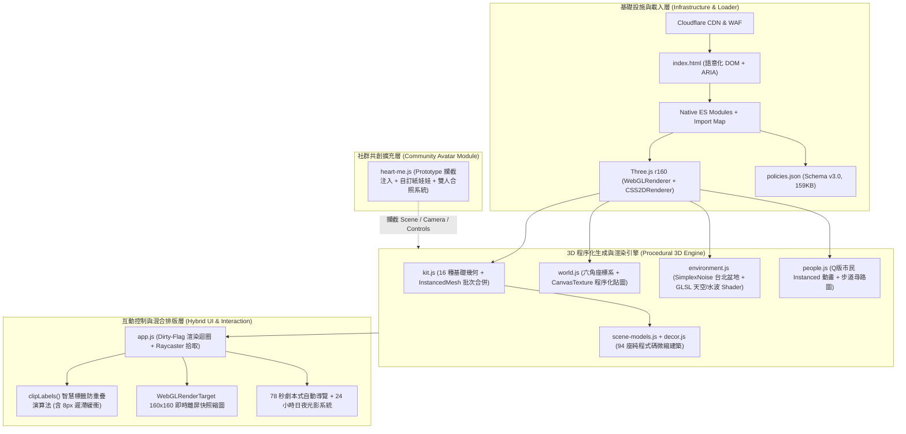

# 專案執行與討論紀錄 (Project Log)

- **專案名稱**：Island (`puma.taipei/heart-island` 網站技術深度分析 ＆ 馬偕醫學大學 `mmu.edu.tw` 3D 互動校園島精簡重製)
- **起始時間**：2026-10-23 20:33
- **最後更新**：2026-10-24 09:12
- **文件格式**：
  - 專案歷程紀錄：[PROJECT_LOG.md](./PROJECT_LOG.md) & [PROJECT_LOG.html](./PROJECT_LOG.html)
  - 通用網站設計與技術規格書範本：[WEBSITE_SPEC_TEMPLATE.md](./WEBSITE_SPEC_TEMPLATE.md) & [WEBSITE_SPEC_TEMPLATE.html](./WEBSITE_SPEC_TEMPLATE.html)
  - 馬偕醫學大學 3D 互動校園島專屬重製規格書：[MMU_REMAKE_SPEC.md](./MMU_REMAKE_SPEC.md) & [MMU_REMAKE_SPEC.html](./MMU_REMAKE_SPEC.html)
  - 馬偕醫學大學 3D 互動校園島可執行網站原型：[index.html](./index.html)、[mmu-ui.css](./mmu-ui.css)、[mmu-data.js](./mmu-data.js)、[mmu-app.js](./mmu-app.js)、[vendor/three-bundle.js](./vendor/three-bundle.js)
  - 專案開源說明與 GitHub 配置：[README.md](./README.md)、[.gitignore](./.gitignore)

---

## 1. 專案規範與設定 (Project Guidelines)
- **記錄要求**：在專案進行期間，所有討論過程、執行過程與最終成果，皆需同步記錄於專案資料夾中。
- **逾時保護機制**：若網站分析超過 5 分鐘無法取得內容或遭遇錯誤，自動中止分析流程。
- **產出格式**：
  1. `PROJECT_LOG.md`（Markdown 格式，便於版本控管與純文字編輯）
  2. `PROJECT_LOG.html`（HTML 格式，具備視覺樣式與結構排版，便於直接於瀏覽器瀏覽）

---

## 2. 討論與決策歷程 (Discussion & Decisions)
- **2026-10-23 20:33**：
  - 用戶提出建立雙格式（MD / HTML）專案歷程記錄規範。
  - 初始化專案紀錄架構。
- **2026-10-23 20:34**：
  - 用戶提供目標網址 `https://puma.taipei/heart-island`（沈伯洋「HEART 政策島」互動網站），要求分析該網站運用的技術並提供完整說明。
  - 初次使用 PowerShell `Invoke-WebRequest` 時因背景工作等待逾時未回傳。
- **2026-10-23 21:48**：
  - 用戶補充「5 分鐘逾時或遇錯自動中止」之保護條件。
  - 改用原生 `curl.exe -s -L --max-time 15` 搭配明確超時控制，於 **6 秒內** 成功抓取網頁 Header、HTML 原始碼與全套共 13 個前端模組與資料檔，順利完成全站程式碼級別之深度逆向與技術拆解。
- **2026-10-23 22:07**：
  - 用戶要求將分析內容提煉並撰寫成一份「建議的規格書」，作為未來設計同類型互動網站的參考範本。
  - 產出獨立雙格式規格書範本（`WEBSITE_SPEC_TEMPLATE.md` 與 `WEBSITE_SPEC_TEMPLATE.html`），並同步更新至本專案紀錄檔。
- **2026-10-23 22:24**：
  - 用戶啟動 `/grill-me` 互動訪談模式，提供目標網站 `https://www.mmu.edu.tw/`（馬偕醫學大學官網），希望參考前述規格架構進行「精簡重製（Simplified Remake）」，並要求先分析現有網站並提出具體重製建議。
  - 完成 `mmu.edu.tw` 首頁、學術單位、行政單位與校園導覽圖之抓取與結構分析，並啟動逐步決策訪談。
- **2026-10-23 22:35**：
  - 完成 `/grill-me` 五大設計決策樹訪談，用戶拍板定案：
    1. **Q1 定位與島嶼規模**：採「7 座六角島完整校務入口版」（27 座微縮地標，含獨立「行政與數位校務島」）。
    2. **Q2 3D 動態視覺特色**：保留「三芝背山面海地形 + 四時段光影（清晨／白天／三芝夕陽／星空）+ 6 條跨島跨域協作光管 + Q 版師生與馬偕博士（Dr. MacKay）彩蛋角色巡禮」；捨棄高複雜度紙娃娃試衣間與城市日誌。
    3. **Q3 頂部與底部互動控制**：底部改為「4 大訪客身分快速切換（00 全校總覽／01 考生與家長／02 在校學生／03 教職員與校友）」；頂部提供四時段光影按鈕與馬偕博士彩蛋尋訪按鈕。
    4. **Q4 資訊呈現與首屏版面**：採「全螢幕 3D 校園島 + 右側三頁籤整合面板（校園島嶼／最新消息／常用系統與處室）+ 左上角即時焦點輪播膠囊」。
    5. **Q5 交付成果形式**：同時產出「馬偕醫學大學專屬精簡重製規格書（`.md` + `.html`）」與「可直接於瀏覽器雙擊開啟執行的 3D 互動網站原型（`index.html` + `mmu-ui.css` + `mmu-data.js` + `mmu-app.js`）」。
- **2026-10-23 22:55**：
  - 完成 `MMU_REMAKE_SPEC.md` 與 `MMU_REMAKE_SPEC.html` 雙格式專屬重製規格書。
  - 完成 `vendor/three-bundle.js` 本地無 CORS 封裝與 `index.html`、`mmu-ui.css`、`mmu-data.js`、`mmu-app.js` 全套 3D 互動校園島原型建置，並通過 `node --check` 語法驗證。
- **2026-10-23 23:13**：
  - 用戶指示「先記錄起來，明天繼續看」。已將今日所有分析報告、規格書範本、馬偕醫學大學專屬重製規格書與 3D 互動校園島原型之當前狀態與明日續看快速導覽完整封存記錄於 `PROJECT_LOG.md` 與 `PROJECT_LOG.html`（見第 9 節）。
- **2026-10-24 08:13 - 08:24**：
  - 用戶附上畫面截圖回饋兩項重點優化需求：
    1. **修正資料映射（消除 `[object Object]` 與 `undefined`）並精簡呈現**：原因為 `mmu-data.js` 採用 `{ zh, en }` 雙語物件結構與 `isl.number` 編號，而初版渲染器直接讀取屬性字串。已於 `mmu-app.js` 導入統一雙語正規化函式 `L(val)` 與 `islCode(isl)`，並補齊 `mmu-data.js` 新聞與系統分類欄位，經自動化測試驗證全站 **288 個文字節點 100% 正常映射（0 個錯誤字串）**。
    2. **各建築製作得更擬真精細並拉開島上配置**：
       - 修正正規化座標換算（`BUILDING_SPREAD = 9.0`），讓每座島嶼上的 3～4 棟建築各自座落於獨立象限，並鋪設連接島嶼中央廣場的放射狀花崗岩步道。
       - 移除原本與 HTML 浮動標籤重複疊影的 3D 屋頂大招牌，改為高精細建築本體 + 清晰單一的 CSS2D 浮動標籤。
       - 全面升級 27 座地標之建築幾何細節（新增多層樓立面窗格 `addWindowGrid`、轉角壁柱、一樓玻璃大門與雨遮、屋頂女兒牆與空調冷卻塔 `addRoofDetails`、哥德式禮拜堂扶壁與玫瑰花窗、牛津學堂四角尖塔、雙螺旋 DNA 雕塑、地壺球賽道、帶車輪與車窗之擬真救護車與校園接駁巴士 `addVehicle` 等）。
- **2026-10-24 08:59 - 09:04**：
  - 用戶提出三項三芝在地特色與校園空間體驗強化需求，已全數實作於 `mmu-app.js`：
    1. **新增 12 座跨島景觀大橋與島內連接幹道系統**：自動偵測 7 座六角島間所有相鄰邊（6 條中央放射主幹道＋6 條外環島際連通線），鋪設含白石路緣與金色雙向中線的島內柏油幹道，並架設 12 座跨海大橋（含海底雙石造橋墩、微拱橋面、雙側石柱安全護欄、4 盞橋上暖光路燈；中央 6 座主橋更配有松石綠與純白雙側鋼拱桁架 Arch Truss）。
    2. **新增三芝特產「茭白筍（美人腿）」主題造景裝飾**：參考三芝名產茭白筍「下半部潔白圓潤飽滿、上半部修長微彎收尖、外層半剝開翠綠筍殼與修長葉片」之外型，設計 `addSingleWaterBamboo()`、`addWaterBambooSculpture()`（設置於每座島中央廣場水池花台的「三芝美人腿」三株景觀雕塑座）與 `addWaterBambooPatch()`（設置於每座島南北綠地的「三芝水梯田茭白筍生態造景畦」）。
    3. **新增各島師生休憩座椅與戶外家具**：於每座島嶼增設 `addPergolaLounge()`（木構藤架涼亭與 L 型軟墊戶外沙發＋木茶几）、`addCafeParasolSet()`（露天遮陽傘咖啡圓桌四椅組）、`addPicnicTable()`（草地野餐共學木桌椅組）及帶扶手靠背之廣場木長椅 `addBench()`。
- **2026-10-24 09:10 - 09:12**：
  - 用戶提出「我想將這個專案部署到 GitHub 上，請告訴我應該怎麼做」。
  - 診斷本機環境：已具備 Git 2.54.0。因本專案為零建構、純靜態架構（所有路徑皆為相對路徑 `./`），極適合透過 GitHub 託管並利用 **GitHub Pages** 提供全球免費 CDN 靜態網站訪問。
  - 完成專案 GitHub 規格化準備：
    1. 建立 `.gitignore`（忽略作業系統暫存與編輯器快取）。
    2. 建立專業雙語 `README.md`（完整標註專案特色、7 島 27 建築、本地執行與 GitHub Pages 部署說明）。
    3. 執行 `git init -b main` 並將全站檔案加入暫存區（Stage）。
    4. 撰寫完整部署指引（包含身分設定、遠端關聯與 GitHub Pages 啟用步驟，記錄於第 10 節）。
- **2026-10-24 09:18 - 09:22**：
  - 用戶指示「也請幫我增加手動上傳的操作步驟」。
  - 於第 10 節增補「GitHub 網頁版直接拖曳手動上傳」（免裝軟體、免敲終端機指令、瀏覽器可視化上傳）與「GitHub Desktop 官方圖形化工具」詳細操作教學，並提醒資料夾與大檔案拖曳之上傳技巧。

---

## 3. 執行過程 (Execution Process)
- [x] 初始化專案目錄與紀錄文件架構（`PROJECT_LOG.md` & `PROJECT_LOG.html`）。
- [x] 使用 `curl.exe` 搭配 `--max-time` 安全抓取 `https://puma.taipei/heart-island` HTTP 標頭與 HTML 結構。
- [x] 解析 HTML `<script type="importmap">` 與 `<base href="/heart-island-assets/">` 資源配置。
- [x] 下載並分析全站 13 個核心資產檔案：
  - `page.html` (11.5 KB)：DOM 骨架、HUD 控制列、無障礙 ARIA 標籤與 Import Map。
  - `ui.css` (56.2 KB)：響應式介面、毛玻璃卡片、Bottom Sheet 手機抽屜與深淺色主題變數。
  - `app.js` (113.5 KB)：主應用程式邏輯、Three.js 渲染迴圈、鏡頭飛行、智慧標籤防重疊演算法、GA4 追蹤與 QA 除錯介面。
  - `kit.js` (6.3 KB)：16 種基礎幾何體定義與 `THREE.InstancedMesh` 批次實例化渲染引擎。
  - `world.js` (27.0 KB)：六角軸座標系統（Axial Hex Grid）、程序化 Canvas 地面貼圖、懸崖階層與跨島橋樑、行人尋路圖（Walkway Graph）。
  - `scene-models.js` (32.1 KB) & `models-extra.js`：94 座政策微縮建築之純程式碼程序化建模（Procedural 3D Modeling）。
  - `environment.js` (25.3 KB)：SimplexNoise 台北盆地山脈生成、自訂 GLSL 天空與水波 Shader、24 小時 10 關鍵影格日夜光影系統。
  - `decor.js` (72.9 KB)：島嶼周邊景觀細節、海岸線、燈塔、渡輪航線（Bezier 曲線）與夜間暖光池。
  - `people.js` (34.0 KB)：14 種 Q 版市民角色（含彩蛋角色 Puma）、配件系統與 Instanced 骨骼擺動動畫。
  - `heart-me.js` (108.0 KB)：收錄自開源社群（原作者 `readper`）的「我的角色」自訂紙娃娃、A* 路網導航與雙人擺拍系統。
  - `policies.json` (159.0 KB)：Schema v3.0 結構化政策資料庫（14 島、94 細項、20 協作線、78 秒導覽腳本）。
  - `icons.js` (2.1 KB) & `analytics.js` (0.7 KB)：SVG 圖示庫與 GA4 `dataLayer` 事件封裝。
- [x] 整理完整技術架構分析報告並同步寫入 `PROJECT_LOG.md` 與 `PROJECT_LOG.html`。
- [x] 將分析成果提煉為可複用之《3D 互動敘事與資訊視覺化網站設計與技術規格書範本》，產出 `WEBSITE_SPEC_TEMPLATE.md` 與 `WEBSITE_SPEC_TEMPLATE.html`，並同步記錄於本檔案第 5 節。
- [x] 抓取並分析馬偕醫學大學官網 (`https://www.mmu.edu.tw/`) 之現行技術架構、資訊階層與無障礙配置，提出「馬偕 3D 互動校園島」精簡重製建議（記錄於第 6 節）。
- [x] 透過 `/grill-me` 逐步與用戶確認精簡重製之範圍、島嶼劃分、保留功能與實作產出（共 5 道決策題全數對齊，記錄於第 7 節）。
- [x] 撰寫並產出《馬偕醫學大學 3D 互動校園島精簡重製規格書》（`MMU_REMAKE_SPEC.md` & `MMU_REMAKE_SPEC.html`）。
- [x] 建置可直接執行之「馬偕醫學大學 3D 互動校園島」原型網站（`index.html`, `mmu-ui.css`, `mmu-data.js`, `mmu-app.js`, `vendor/three-bundle.js`），支援 `file://` 直接雙擊開啟零 CORS 錯誤（記錄於第 8 節）。
- [x] 完成 v2.0 優化：徹底修復雙語資料映射（0 處 `[object Object]` / `undefined`）並精細化 27 座微縮建築（立面窗格、壁柱、門廊、救護車、接駁巴士與雙螺旋 DNA 雕塑）。
- [x] 完成 v2.1 升級：架設 12 座跨島景觀大橋與島內幹道、增設三芝茭白筍（美人腿）水池雕塑與水梯田造景畦、配置木構藤架涼亭沙發與露天咖啡桌椅。
- [x] 建立 GitHub 部署基礎設施：建立 `.gitignore`、`README.md`、初始化 Git 主分支並彙整 GitHub Pages 一鍵部署手冊（記錄於第 10 節）。

---

## 4. 執行成果：`puma.taipei/heart-island` 網站技術深度分析報告

### 4.1 網站定位與核心設計概念
**「HEART 政策島」** 是台北市長參選人沈伯洋（Puma）推出的 3D 互動政見平台。設計靈感致敬經典桌遊《卡坦島 (Catan)》，將台北市輪廓轉化為 **14 個等大六邊形島嶼**，承載 **94 個政策細項微縮模型** 與 **20 條跨政策協作線（Flows）**，並結合 **HEART** 五大核心理念（**H**abitat 空間、**E**mpower 培力、**A**ccompany 陪伴、**R**esilience 韌性、**T**ime 時間）。

---

### 4.2 技術架構總覽 (Architecture Diagram)



---

### 4.3 八大關鍵技術亮點詳解

#### 1. 無打包器原生 ES Modules 架構 (Vanilla JS + Native ESM + Import Maps)
- **零重型前端框架**：網站完全不依賴 React、Vue 或 Angular，也不透過 Webpack/Vite 將程式碼編譯為單一肥大的混淆 Bundle。
- **原生模組化**：利用瀏覽器原生 `<script type="importmap">` 將 `"three"` 與 `"three/addons/"` 映射至站內自託管的 **Three.js r160** 模組目錄，並將業務邏輯乾淨拆分為 11 支職責分明的 ES Module（`app.js`, `world.js`, `kit.js`, `environment.js`, `people.js` 等）。
- **極速首屏載入**：透過 `<base href="/heart-island-assets/">` 與版本號 Query String（如 `?v=20261022-4`）進行快取控制，無須下載任何外部 `.gltf` / `.glb` 3D 模型或大型貼圖檔，全站核心程式碼與資料總計僅約 **600 KB**。

#### 2. 100% 純程式碼程序化 3D 建模与 `InstancedMesh` 批次渲染 (`kit.js`, `scene-models.js`)
- **零外部 3D 模型資產 (Zero External 3D Assets)**：場景中多達 94 座精細的政策微縮建築（如雙翼市政大樓、玻璃圓頂研究館、貓空纜車與茶園、A 字木屋登山站、伙房式照護站等）及數千棵樹木，**全部由 JavaScript 程式碼以幾何原件組合而成**。
- **`kit.js` 批次實例化引擎**：
  - 定義了 16 種基礎幾何體（`box`, `rbox` 圓角方塊, `cylinder`, `cone`, `sphere`, `ico`, `dome`, `torus`, `tetra`, `hip` 四坡屋頂, `prism`, `leaf` 頂點擾動樹葉等）。
  - 建模時所有零件先登記至 `batches` Map，最後由 `kit.build()` 按幾何類型一次性轉換為 **`THREE.InstancedMesh`**。這讓成千上萬個建築零件僅需十幾次 WebGL Draw Calls 即可畫完！
- **微米級防 Z-Fighting（共面閃爍）設計**：
  - 針對窗戶、招牌等貼合表面的零件設定不同的 `polygonOffset` 深度優先權。
  - 在寫入每個實例的 Transform Matrix 時，加入確定性極小縮放抖動 `1 + (((n * 7) % 9) - 4) * 0.0018`，徹底消除兩個相同幾何面重疊時的閃爍問題。

#### 3. 六角網格座標系與 Canvas 2D 程序化貼圖 (`world.js`)
- **卡坦島式六角軸座標 (Axial Hexagonal Grid)**：
  - 採用尖頂六邊形（Pointy-top Hexagon，外接圓半徑 `R = 2.02`、間距 `SPACING = 2.28`），透過 `axialToWorld(q, r)` 將二維六角網格座標 `(q, r)` 映射為台北市輪廓的 14 座立體島嶼。
- **HTML5 Canvas 動態生成材質貼圖 (`makeTexture`)**：
  - 不載入任何外部 PNG/JPG 地面紋理，而是以 `document.createElement("canvas")`（256×256）搭配確定性亂數產生器 `mulberry(seed)`，即時繪製出 14 種地面材質（花崗岩磚、操場跑道線、農田畦溝、四色兒童軟墊、木棧道、碎石地、草地與小花斑點等），再轉為 `THREE.CanvasTexture`。
  - 場景中的 3D 建築立牌（如「兒少安全治理中心」、「都會伯公照護站」）與城市外交碼頭看板，同樣使用 Canvas 2D 即時渲染繁體中文字體並開啟自發光（`emissiveMap`）。

#### 4. 台北盆地程序化地形與客製化 GLSL Shaders (`environment.js`)
- **SimplexNoise 台北盆地山系模擬**：
  - 使用 `SimplexNoise` 與 4 階分形布朗運動（FBM），結合 10 個地理特徵控制點（北側七星山火山圓頂、西側觀音山、東側南港四獸山脈、南側貓空茶園階梯地形），即時計算出環繞城市的盆地山脈頂點高度與坡度頂點著色（Vertex Colors）。
  - **貼心視角壓低演算法**：透過計算方位角 `Math.atan2(wx - cx, wz - cz)`，自動將預設鏡頭正前方（南側前景）的山丘高度乘上衰減係數，確保山脈永遠不會擋住政策島視線。
- **三大客製化 GLSL Shader (`THREE.ShaderMaterial`)**：
  1. **天空穹頂 (Sky Dome Shader)**：根據太陽向量計算大氣散射漸層與日暈，並在夜晚（`uNight`）利用 3D 雜湊函數 `hash(floor(vDir * 180.0))` 程序化點亮滿天星斗。
  2. **抗鋸齒風格化水面 (Stylised Water Shader)**：雙重正弦波疊加產生柔和波浪，並使用 GLSL 導數函數 `fwidth(w2)` 進行距離抗鋸齒，消除遠處水波紋的摩爾紋（Aliasing），同時支援日間波光粼粼（Glint）與遠景霧化（Fog）。
  3. **協作線動態光管 (Flow Tube Shader)**：在連接不同島嶼的 `TubeGeometry` 上，透過 Fragment Shader 計算 `fract(vUv.x * uLen * 5.0 - uTime * 1.4)` 產生流動脈衝，並依證據等級（`uMode`）使用 `discard` 動態裁切出實線、長虛線與短虛線。
- **24 小時日夜光影循環 (`KEYS` Keyframe System)**：
  - 內建從 `00:00` 到 `24:00` 共 10 組關鍵影格，平滑插值天空色、太陽角度、陰影、水面色調，並在夜間自動點亮建築窗戶（`glowMat`）、路燈下的暖色光池（`AdditiveBlending`）、旋轉燈塔光束、岸邊燈串與山腰村落燈火。

#### 5. Q 版市民尋路系統與即時離屏快照縮圖 (`people.js`, `app.js`)
- **步道連通圖與動態市民 (`createPeople`)**：
  - 沿著每座島嶼的環狀步道與跨島橋樑建立節點圖（Graph），讓代表 20 條協作線的 Q 版市民（公務員、研究員、推嬰兒車的家長、騎單車通勤族、小農、長者等）手持對應道具（藍圖、晶片、書包、樹苗、菜籃等）在政策島之間實際走動並進行「交接（Handoff）」，同步觸發右側「城市日誌（City Log）」的 LIVE 事件流。
  - **彩蛋角色 Puma**：身穿白襯衫、競選橘背心與小浪花別針、頂著捲髮與黑框眼鏡的 Q 版沈伯洋，會按照 01 到 14 號政策島順序逐一巡迴，每到一格就站上「肥皂箱（Soapbox）」向市民揮手。
- **`WebGLRenderTarget` 即時 3D 特寫快照 (`thumbnail` / `portrait`)**：
  - 當使用者點擊任一政策細項建築或路上的市民時，系統不需要預先準備 94 張縮圖圖片，而是瞬間將隱藏的專屬相機 `thumbCam` 移至該建築/小人前方，渲染至 `160×160`（4x MSAA）的 `THREE.WebGLRenderTarget` 離屏緩衝區，再透過 `renderer.readRenderTargetPixels()` 讀取像素並轉成 `image/jpeg` DataURL 塞入資訊卡標題旁！

#### 6. 2D/3D 混合介面與智慧防重疊演算法 (`CSS2DRenderer` + `clipLabels`)
- **空間錨定標籤**：利用 `CSS2DRenderer` 將 HTML DOM 標籤（島嶼按鈕、建築編號針腳 `①~⑳`、市民頭頂名牌）即時投影並跟隨 3D 座標。
- **`clipLabels()` 智慧避障與遲滯防抖（Hysteresis）**：
  - 每一幀自動偵測所有 3D 標籤與畫面四周 UI 面板（標題列、側邊欄、詳細卡片、時間軸）的碰撞關係。
  - 若發生遮擋，標籤會自動依序嘗試 **7 個方向的微幅位移** → 若仍碰撞則 **自動縮小為純數字徽章（`.mini` / `.numonly`）** → 或 **滑出面板邊緣（`.slid`）** → 最終才隱藏。
  - 引入 **8px 遲滯緩衝（Hysteresis）**：上一幀被收合或隱藏的標籤，下一幀必須有超過 8px 的淨空餘裕才會重新展開，完美解決了 3D 鏡頭微動時 DOM 標籤高頻閃爍跳動的常見痛點。

#### 7. 社群共創模組注入技術：`heart-me.js`（「我的角色」自訂紙娃娃系統）
- **開源社群收錄**：此模組原為開發者 `readper` 在 GitHub 發布的第三方 Userscript（`readper/heart-island-me` v0.7.1），於 2026-10-23 獲作者授權直接整合進官網。
- **無侵入式 Prototype 攔截 (`hook()`)**：
  - 為了在不大幅改動 `app.js` 封閉作用域的情況下取得 3D 場景控制權，`heart-me.js` 透過攔截 `THREE.Scene.prototype.updateMatrixWorld`、`THREE.Camera.prototype.updateMatrixWorld` 與 `THREE.EventDispatcher.prototype.dispatchEvent`，在第一幀渲染時自動捕獲站方的 `scene`、`camera` 與 `OrbitControls` 實例。
- **逆向路網重建與背景預計算 (`buildNet` & Generator Time-Slicing)**：
  - 從 `window.heartCity.pedestrianRoutes` 匯出的 89 條路線點位中，以 `0.06` 容差合併相鄰座標，重建出全島連通導航路網（Graph），支援點擊任意政策建築自動尋路前往。
  - 試衣間位置需要發射上千條 Raycast 射線尋找開闊地面，系統採用 **JavaScript Generator (`function* computeFitSpot`) + `requestAnimationFrame` 分片執行（Time-Slicing）**，在背景分幀算完，確保打開面板時完全不掉幀。
- **紙娃娃系統與雙人擺拍**：提供 13 種身分預設、9 種髮型、5 種服裝、7 種帽子、9 種手持物、身高/體寬滑桿與自訂選色器（自動存於 `localStorage`），並支援召喚「複製版 Puma」在任意景點並肩調整羅盤角度合照。

#### 8. 效能調校、無障礙設計 (A11y) 與 QA 自動化介面
- **自適應畫質與 Dirty-Flag 省電渲染**：
  - 根據螢幕尺寸與行動裝置自動切換畫質設定，並在鏡頭距離超過閾值（`camDist > 26`）時自動隱藏細小裝飾物（LOD, Level of Detail）與遠處雲朵（Frustum Culling）。
  - 實作 `dirty` 旗標：當畫面靜止且無動畫時不重複執行 WebGL 繪製。
- **高標準無障礙支援 (Accessibility)**：
  - 全面偵測 `prefers-reduced-motion: reduce`：一旦系統開啟減少動態效果，立即關閉鏡頭飛行過渡、停止水波/光管流動與自動時間推進。
  - 支援鍵盤方向鍵旋轉 3D 城市、`Escape` 階層式關閉彈窗、完整 ARIA 屬性與語意化側邊清單（讓螢幕閱讀器使用者不需操作 3D Canvas 也能完整瀏覽 14 項主題與 94 個細項）。
- **內建工程級 QA 除錯與自動化測試鉤子 (`window.heartCity`)**：
  - 程式碼中保留了極為嚴謹的自動化驗證介面（如 `?debug=silhouette` 剪影檢查、`?debug=occupancy` 佔地檢查、`?ratio=9x16` 直式短影音錄製模式、`heartCity.debug.flowRouteCheck()` 驗證所有小人是否精確走在步道邊上、`heartCity.debug.luminance()` 測量畫面平均亮度等），展現出極高水準的工程品質控制。

---

### 4.4 技術堆疊彙整表 (Summary Table)

| 技術領域 | 採用技術 / 方案 | 關鍵實作細節與檔案位置 |
| :--- | :--- | :--- |
| **前端核心架構** | Vanilla JavaScript (ES2022+) | 原生 ES Modules + `<script type="importmap">`，無框架、無打包器混淆 (`app.js`) |
| **3D 渲染引擎** | Three.js `r160` (WebGL 2) | `PCFSoftShadowMap`、`SRGBColorSpace`、`ACESFilmicToneMapping` (`app.js`) |
| **3D 建模方式** | 100% 程式碼程序化建模 | 零外部 `.gltf`/`.obj` 檔案，由 16 種基礎幾何組合出 94 座微縮建築 (`kit.js`, `scene-models.js`) |
| **渲染效能優化** | `THREE.InstancedMesh` + LOD | 靜態建築與高達 7,000 棵樹木全面批次實例化；距離 LOD 與 Dirty-Flag 按需重繪 (`kit.js`, `environment.js`) |
| **貼圖與材質** | HTML5 `CanvasTexture` + PRNG | 使用 2D Canvas 與 `mulberry` 確定性亂數動態繪製 14 種地面紋理與 3D 中文招牌 (`world.js`, `app.js`) |
| **地形與環境特效** | `SimplexNoise` + Custom GLSL | FBM 雜訊生成台北盆地山脈；自訂 GLSL Vertex/Fragment Shaders 渲染星空、抗鋸齒水波與動態虛線光管 (`environment.js`, `app.js`) |
| **2D/3D 混合 UI** | `CSS2DRenderer` + `clipLabels()` | 3D 空間錨定 DOM 標籤，配備每幀碰撞偵測、自動位移、徽章收合與 8px 遲滯防閃爍演算法 (`app.js`, `ui.css`) |
| **即時縮圖生成** | `THREE.WebGLRenderTarget` | 160×160 (4x MSAA) 離屏相機即時拍攝 3D 建築與市民大頭貼，轉成 JPEG DataURL (`app.js`) |
| **角色與尋路系統** | Graph 路網 + Instanced 角色 | 六邊形環島步道與跨島橋樑構成尋路圖；14 種角色部件透過 InstancedMesh 驅動步態動畫 (`world.js`, `people.js`) |
| **社群紙娃娃系統** | Prototype Hooking + Time-Slicing | 攔截 Three.js Prototype 注入自訂角色、Generator 分幀 Raycast 預計算、LocalStorage 造型保存 (`heart-me.js`) |
| **資料與多語系** | JSON Schema v3.0 + URL Params | `policies.json` 統一管理政見、協作線與導覽腳本；支援 `?lang=en` 中英雙語與 `?ratio=9x16` 社群直式構圖 |
| **CDN 與數據分析** | Cloudflare + Google Analytics 4 | Cloudflare 邊緣防護 (`cf-cache-status: BYPASS`) + 自訂 `dataLayer` 互動追蹤 (`analytics.js`) |

---

## 5. 延伸交付成果：未來設計網站之建議規格書範本 (`WEBSITE_SPEC_TEMPLATE`)

已將 `puma.taipei/heart-island` 的架構精髓提煉為通用型《**3D 互動敘事與資訊視覺化網站設計與技術規格書範本 (v1.0)**》，並儲存為獨立雙軌檔案：
- **Markdown 規格書範本**：[WEBSITE_SPEC_TEMPLATE.md](./WEBSITE_SPEC_TEMPLATE.md)
- **HTML 規格書範本**：[WEBSITE_SPEC_TEMPLATE.html](./WEBSITE_SPEC_TEMPLATE.html)

### 規格書七大核心章節摘要
1. **專案願景與核心設計哲學**：定義「桌遊化微縮世界隱喻」、「關聯性動態流動視覺化」、「零外部 3D 模型之純程式碼程序化生成（Zero-Asset Procedural 3D）」與「3D 視覺／語意化文字雙軌並重」四大原則。
2. **系統架構與模組化規範**：規範 Vanilla JS (ES2022+) + Native Import Map + Three.js r160 雙渲染器架構，以及 12 支標準模組檔案（`app.js`, `kit.js`, `world.js`, `scene-models.js`, `environment.js`, `decor.js`, `people.js`, `avatar-mod.js`, `data.json` 等）之職責邊界。
3. **3D 場景與程序化視覺規格**：明訂尖頂六角軸座標轉換公式、16 種幾何原件池與 `THREE.InstancedMesh` 批次合併引擎、防 Z-Fighting 雙重機制（`polygonOffset` + 確定性微米縮放抖動）、Canvas 2D 程序化地面貼圖與 3D 招牌、SimplexNoise 環場地形（含鏡頭前景自動壓低公式）、三大客製化 GLSL Shaders 與 24 小時 10 關鍵影格光影系統。
4. **角色尋路系統與自訂化身規格**：規範環島步道連通圖（Walkway Graph）、Instanced Q 版市民步態與搬運交接動畫、彩蛋代表人物巡迴狀態機，以及基於 Generator Time-Slicing（分幀 Raycast 預計算）的紙娃娃試衣間與 360° 羅盤雙人擺拍系統。
5. **2D/3D 混合介面與互動規格**：明訂 `clipLabels()` 四階段碰撞避障演算法與 **8px 遲滯防抖（Hysteresis）**、`160×160` (4x MSAA) `WebGLRenderTarget` 即時離屏快照縮圖、桌面版卡片鏡頭避讓 (`flyTo`) 與四大探索模式（一日作息、階段推進、核心標籤複選、劇本式自動導覽）。
6. **核心資料結構規格範本 (`data.json` Schema v3.0)**：提供完整 JSON 欄位範本（`meta`, `sources`, `islands`, `buildings`, `flows`, `quotes`, `dayCycle`, `termTimeline`, `tour`），支援中英雙語與證據等級標記。
7. **效能預算、無障礙設計與 QA 驗收規範**：明訂首屏未壓縮 `< 800 KB`、Draw Calls `<= 35`、High/Medium/Low 自適應畫質與 `dirty` 旗標按需重繪、WCAG 2.1 AA（`prefers-reduced-motion` 與全鍵盤操作）以及 URL QA 除錯參數（`?debug=silhouette`, `?debug=occupancy`, `?ratio=9x16`, `flowRouteCheck()`）。

---

## 6. 馬偕醫學大學 (`https://www.mmu.edu.tw/`) 現況分析與精簡重製建議

### 6.1 現有網站技術與資訊架構診斷
1. **現行技術堆疊**：
   - **CMS 與後端**：ASP.NET MVC 架構（含 `__RequestVerificationToken` 與 `xmdoc` 內容管理系統）。
   - **前端技術**：傳統多頁式（MPA）網站，依賴 `jQuery 3.7.1`、`Swiper`（首頁 Banner）、`Owl Carousel 2`（校園焦點消息輪播）、`Superfish`（下拉選單）與 `jQuery.mmenu`（手機側欄）。
   - **無障礙標章**：通過數位發展部 **AA 等級無障礙網頁檢測**（具備導盲磚 `:::`、`accesskey` 與字級縮放）。
2. **現行內容結構**：
   - **3 大學院 + 1 中心（共 9 個教學單位）**：
     - **醫學院**：醫學系（含臨床醫學碩士班）、醫學檢驗暨再生醫學學系、視光學系、生物醫學研究所。
     - **護理學院**：護理學系（含碩士班、二年制在職專班）。
     - **厚生健康學院**：聽力暨語言治療學系、長期照護研究所、高齡福祉科技研究所。
     - **全人教育中心**。
   - **校園簡介與馬偕精神**：校長與學校簡介、治校理念、馬偕精神（摩西的故事、馬偕的故事、馬偕紀念醫院的故事、我們的故事）。
   - **行政單位（13 個處室）**：校長室、秘書室、教務處、學務處、總務處、研發處、圖資處等。
   - **重點入口與外部連結**：招生資訊網、新生入學專區、Open Day、校園導覽圖（目前僅為靜態平面圖列表）、家庭式優質宿舍、交通接駁車、USR 推動辦公室、SDGs 永續發展、馬偕紀念醫院醫療體系。
3. **現有痛點與重製契機**：
   - 首頁塞滿輪播圖、3 欄文字新聞、10 張圖片磚（常用連結）與 20 個快速連結按鈕，視覺呈現較平面，難以第一時間向高中生、家長與訪客傳遞**「三芝依山面海的立體校園特色」**與**「醫學 × 護理 × 厚生健康 × 馬偕醫院體系 × 偏鄉 USR 的跨域連結」**。
   - 現有「校園導覽圖」僅為 2D 靜態圖片，極適合升級為輕量化 3D 微縮互動校園島！

### 6.2 「馬偕互動校園島 (MMU Interactive Campus Island)」精簡重製建議
- **地理環境天然契合**：三芝校區「背靠大屯山系、面向台灣海峽與夕陽」的地貌，可直接沿用 `environment.js` 的程序化背山面海 + 日夜夕陽系統。
- **規模精簡化（6～7 座六角島、約 20～25 座微縮建築，複雜度降至原版 1/4）**：
  1. **醫學院島**：醫學系、醫檢暨再生醫學系、視光學系、生物醫學研究所。
  2. **護理學院島**：護理學系、高擬真臨床技能中心。
  3. **厚生健康學院島**：聽力暨語言治療學系、長期照護研究所、高齡福祉科技研究所（含老化感官實驗室）。
  4. **全人與馬偕精神島**：全人教育中心、馬偕博士歷史故事館／禮拜堂、數位校史館。
  5. **校園生活與行政島**：家庭式優質宿舍、圖書館、活動中心、交通接駁總站、行政服務中心。
  6. **招生與國際跨域島**：招生專區／Open Day、台蒙／台美海外醫療實習、馬偕紀念醫院臨床連結、偏鄉 USR 衛教營（三芝／台東／恆春／烏來）。
- **功能取捨建議（精簡版）**：
  - **保留**：3D 六角島與程序化微縮地標、背山面海日夜／三芝夕陽切換、跨島協作光管（如臨床實習線、偏鄉 USR 服務線）、Q 版師生與**彩蛋角色「馬偕博士 (Dr. MacKay)」**巡迴、右側語意化搜尋與無障礙索引欄（兼顧既有 AA 無障礙精神）。
  - **捨棄／簡化**：移除複雜的 `heart-me.js` 紙娃娃試衣間與分幀 Raycast、移除任期時間軸與 LIVE 城市日誌，改為「最新校園焦點 & 招生快速入口」面板。

---

## 7. `/grill-me` 需求對齊決策與專屬重製規格書 (`MMU_REMAKE_SPEC`)

透過 `/grill-me` 互動訪談，與用戶完成五大設計分支決策對齊：

| 決策維度 | 用戶選定方案 | 設計與架構落實細節 |
| :--- | :--- | :--- |
| **Q1. 網站定位與島嶼規模** | **7 座六角島完整校務入口版** | 涵蓋 `01 醫學院島`、`02 護理學院島`、`03 厚生健康學院島`、`04 全人與馬偕精神島`、`05 山海生活與宿舍島`、`06 行政與數位校務島`、`07 招生、醫療體系與國際 USR 島`，共 **27 座程序化微縮建築地標**。 |
| **Q2. 3D 動態視覺特色** | **完整動態體驗（山海夕陽 + 跨島協作線 + 馬偕博士彩蛋）** | 保留北側大屯山系、南側台灣海峽波浪、6 條跨島跨域協作光管與 Q 版師生，並設計身穿黑色禮服、蓄大鬍子、頭戴禮帽、手提醫療袋的 **「馬偕博士 (Dr. MacKay)」彩蛋角色** 巡迴 7 島；移除高複雜度紙娃娃試衣間與城市日誌。 |
| **Q3. 頂部與底部控制列** | **頂部四時段光影按鈕 ＋ 底部 4 大訪客身分快速切換** | 頂部提供 `🌅 清晨`、`☀️ 白天`、`🌇 三芝夕陽`、`🌙 星空` 一鍵光影切換與 `🎩 尋找馬偕博士` 按鈕；底部提供 `00 全校總覽`、`01 考生與家長`、`02 在校學生`、`03 教職員與校友` 身分切換，點擊時 3D 對應島嶼外框自動發光高亮並展開專屬快速入口膠囊列。 |
| **Q4. 資訊呈現與首屏版面** | **全螢幕 3D 校園島 ＋ 右側三頁籤整合面板 ＋ 頂部焦點膠囊** | 全視窗 `100dvh` 3D 畫布；左上角配置即時校務焦點輪播膠囊（如 11/7 Open Day、116 學年度招生、醫檢師國考榜首）；右側面板整合 **3 大頁籤**：`🏝️ 校園島嶼 (27)`、`📰 最新消息`、`⚡ 常用系統與處室`。 |
| **Q5. 最終交付成果形式** | **同時產出「專屬重製規格書」與「可直接執行的 3D 互動網站原型」** | 產出雙格式專屬規格書（`MMU_REMAKE_SPEC.md` & `MMU_REMAKE_SPEC.html`）以及零外部 3D 模型、支援 `file://` 直接雙擊開啟的完整互動網站原型。 |

### 專屬重製規格書交付清單
- **Markdown 版**：[MMU_REMAKE_SPEC.md](./MMU_REMAKE_SPEC.md)
- **HTML 視覺化版**：[MMU_REMAKE_SPEC.html](./MMU_REMAKE_SPEC.html)

---

## 8. 最終交付成果：馬偕醫學大學 3D 互動校園島可執行網站原型

已於專案資料夾 `c:\Google\Antigravity\Island\` 建置完成可直接雙擊開啟（支援 `file://` 協定零 CORS 錯誤，亦支援任何靜態 HTTP 伺服器部署）的完整 3D 互動校園島原型：

### 8.1 原型檔案結構清單
1. **[index.html](./index.html)**：語意化 HTML5 主入口，包含無障礙跳轉連結（Skip Link）、左上角品牌與即時焦點輪播膠囊、右上角四時段光影與馬偕博士彩蛋 HUD、右側三頁籤資訊中心（島嶼導覽／最新消息／常用系統與處室）、左下角建築詳情浮動卡、底部 4 大訪客身分切換列與導覽說明彈窗。
2. **[mmu-ui.css](./mmu-ui.css)**：毛玻璃（Glassmorphism）深色海灣主題樣式表、RWD 響應式平板與手機底部抽屜（Bottom Sheet）佈局、3D CSS2D 錨定標籤樣式與 WCAG 2.1 AA 焦點外框設計。
3. **[mmu-data.js](./mmu-data.js)**：馬偕醫學大學完整結構化資料庫（`window.MMU_DATA`），內含 7 座六角島軸座標、27 座微縮建築地標（含對象、簡介、3 點精要事實、跨島協作流向與官網深層連結）、6 條跨島跨域協作光管、4 大訪客身分、12 則真實校園新聞公告、10 大行政處室分機表與 20 個數位校務系統入口。
4. **[mmu-app.js](./mmu-app.js)**：Three.js 3D 互動引擎主程式，實作：
   - `createKit()`：基礎幾何體 `THREE.InstancedMesh` 批次實例化渲染引擎與程序化樹木／路燈／長椅生成。
   - `buildBuildingModel()`：100% 純程式碼程序化建模 27 座馬偕特色微縮地標（大體解剖天窗教學樓、DNA 雙螺旋生醫塔、視光光學環圓頂、南丁格爾金燈護理館、OSCE 救護車臨床中心、聽語聲波館、馬偕紀念禮拜堂、牛津學堂紅磚尖塔、焚而不毀火炬紀念碑、家庭式雙塔宿舍、山海景觀玻璃圖書館、三芝接駁轉運站、馬偕醫院直升機停機坪聯結站、北海岸 USR 基地與國際交流燈塔碼頭等）及 Canvas 2D 屋頂招牌。
   - `createEnvironment()`：北側大屯山群、南側台灣海峽動態海浪、夜空星群與四時段光影插值系統（`清晨`、`白天`、`三芝夕陽`、`星空` 夜間窗戶自發光）。
   - `createPeople()`：跨島協作曲線 Q 版師生與**「馬偕博士 (Dr. George Leslie MacKay)」彩蛋角色**（黑色禮服、落腮鬍、高禮帽、手提醫療袋、金色光環）自動巡迴 7 島。
   - `generateBuildingThumbnails()` & `clipLabels()`：啟動時透過 `THREE.WebGLRenderTarget` 即時離屏拍攝 27 座建築 3D 頭像縮圖，並於每幀執行 DOM 標籤碰撞剔除與 8px 遲滯防抖（Hysteresis）。
5. **[vendor/three-bundle.js](./vendor/three-bundle.js)**：自包含封裝之 Three.js `r160` 核心與 `OrbitControls`、`CSS2DRenderer`、`RoundedBoxGeometry`（1.31 MB），確保本機直接以 `file://` 雙擊 `index.html` 時無須網路或本機 Server 即可 100% 正常運行。

---

## 9. 階段存檔檢核點與明日續看快速指南 (Session Checkpoint — 2026-10-23 23:13)

### 9.1 明日開啟與體驗順序建議
1. **直接體驗 3D 互動校園島原型**：
   - 於檔案總管直接雙擊開啟 `c:\Google\Antigravity\Island\index.html`。
   - **推薦體驗動線**：
     - 點擊右上角 **`🌅 清晨 / ☀️ 白天 / 🌇 三芝夕陽 / 🌙 星空`** 觀察三芝大屯山海光影與夜間窗戶亮燈變化。
     - 點擊右上角 **`🎩 尋找馬偕博士`**，鏡頭將自動飛往正在巡迴 7 座島嶼的馬偕博士彩蛋角色，並開啟「寧願燒盡，不願銹壞」歷史故事卡片。
     - 點擊底部 **`01 考生與家長 / 02 在校學生 / 03 教職員與校友`**，觀察對應 3D 島嶼外框高亮發光與專屬快速入口膠囊列。
     - 在右側面板切換 **`🏝️ 校園島嶼 (27)`**、**`📰 最新消息`**、**`⚡ 常用系統與處室`** 三大頁籤，或點擊任一微縮建築查看跨島協作流向與官網連結。
2. **檢視規格書與紀錄文件（支援直接以瀏覽器開啟 `.html` 版）**：
   - **專案全程紀錄**：`PROJECT_LOG.html`（或 `PROJECT_LOG.md`）
   - **馬偕醫學大學專屬精簡重製規格書**：`MMU_REMAKE_SPEC.html`（或 `MMU_REMAKE_SPEC.md`）
   - **通用型 3D 互動網站設計規格書範本**：`WEBSITE_SPEC_TEMPLATE.html`（或 `WEBSITE_SPEC_TEMPLATE.md`）

### 9.2 明日可接續討論或微調之方向（待用戶檢視後決定）
- **視覺與 3D 模型微調**：調整特定建物外觀細節（如馬偕紀念禮拜堂、活動中心、家族式宿舍配色或尺寸）、島嶼間距或三芝山海地形角度。
- **資料與公告串接**：調整 27 座地標之文案介紹、新增更多院系實驗室地標，或規劃如何與學校現有 ASP.NET MVC (`xmdoc`) 後台之最新消息 RSS/JSON API 自動串接。
- **自動導覽劇本（Guided Tour）**：若需要為「Open Day 開放日」或「高中生招生簡報」加入一鍵 60 秒自動運鏡導覽模式，可隨時擴充。

---

## 10. GitHub 專案部署與 GitHub Pages 託管完整指南 (GitHub Deployment Guide)

本專案採用 **零外部 3D 模型、零打包器構建（Zero-Build Static Architecture）**，所有靜態資產均使用相對路徑（`./`），天生 100% 完美相容 GitHub 與 GitHub Pages 免費 CDN 靜態網站託管。

### 10.1 部署前環境已完成之準備工作
- [x] 已在 `c:\Google\Antigravity\Island\` 建立標準 [.gitignore](./.gitignore)。
- [x] 已建立結構完整的開源說明文件 [README.md](./README.md)。
- [x] 已初始化本地 Git 主分支 `main`（`git init -b main`）並將全站檔案加入暫存區（Stage）。

### 10.2 方式一：終端機命令列推送（推薦熟悉指令者，約 1 分鐘）

#### 【步驟 1】在終端機設定您的 Git 身分（若尚未設定過）
若您的本機電腦尚未設定過 Git 提交身分，請在 PowerShell 執行：
```powershell
git config user.name "您的GitHub使用者名稱"
git config user.email "您的GitHub註冊Email"
```

#### 【步驟 2】建立本地首次 Commit 提交
```powershell
git commit -m "feat: complete Mackay Medical University 3D campus island v2.1"
```

#### 【步驟 3】前往 GitHub 建立遠端儲存庫並推送代碼
1. 開啟瀏覽器登入 [GitHub.com](https://github.com/)，點擊右上角 **`+` ➔ New repository**。
2. 填寫儲存庫資訊：
   - **Repository name**：例如 `mmu-island` 或 `mmu-3d-campus`
   - **Visibility**：選擇 **Public**（若使用免費版 GitHub Pages 需設為 Public）
   - **重要**：請**不要**勾選 "Add a README file"、".gitignore" 或 "license"（因為我們本地已經建立好了！）。
3. 點擊 **Create repository**。
4. 複製 GitHub 頁面上顯示的遠端指令，在專案目錄下執行（將網址替換為您的實際網址）：
```powershell
git remote add origin https://github.com/<您的GitHub帳號>/<儲存庫名稱>.git
git branch -M main
git push -u origin main
```

---

### 10.3 方式二：GitHub 網頁端免安裝手動拖曳上傳（推薦不想敲指令者，全圖形化操作）

如果您不想打開命令提示字元或終端機，可以直接使用瀏覽器透過 GitHub 網頁介面上傳所有檔案：

#### 【步驟 1】在 GitHub 建立一個帶有初始檔案的新儲存庫
1. 開啟瀏覽器登入 [GitHub.com](https://github.com/)，點擊右上角 **`+` ➔ New repository**。
2. 填寫儲存庫資訊：
   - **Repository name**：輸入例如 `mmu-island`
   - **Visibility**：選擇 **Public**
   - **關鍵步驟**：請在下方勾選 **「Add a README file」**（這會讓 GitHub 自動建立一個初始頁面，並解鎖網頁上的檔案上傳按鈕）。
3. 點擊綠色按鈕 **Create repository**。

#### 【步驟 2】在網頁點擊上傳檔案功能
1. 進入新建好的儲存庫頁面後，點擊右上方綠色按鈕旁邊的 **「Add file」** ➔ 選擇 **「Upload files」**。
2. 頁面中央會出現大虛線框：**「Drag files here to add them to your repository」**。

#### 【步驟 3】從本機檔案總管拖曳檔案上傳
1. 打開 Windows 檔案總管，進入本專案資料夾：
   `c:\Google\Antigravity\Island\`
2. 選取所有需要上傳的檔案與資料夾：
   - `index.html`（首頁核心檔案）
   - `mmu-ui.css`（樣式表）
   - `mmu-data.js`（資料庫）
   - `mmu-app.js`（3D 引擎）
   - `vendor/` 資料夾（**重要**：整包 `vendor` 資料夾直接拖進去，內含 `three-bundle.js`）
   - `PROJECT_LOG.md` 與 `PROJECT_LOG.html`（專案紀錄）
   - `MMU_REMAKE_SPEC.md` 與 `MMU_REMAKE_SPEC.html`（規格書）
   - `WEBSITE_SPEC_TEMPLATE.md` 與 `WEBSITE_SPEC_TEMPLATE.html`（規格書範本）
   - `README.md`（可直接覆蓋 GitHub 自動生成的 README）
3. 按住滑鼠左鍵，將上述選取的檔案與資料夾**直接拖曳到 GitHub 瀏覽器視窗的虛線框內放開**。
4. 瀏覽器會顯示各檔案的上傳進度條，稍等 10～20 秒直到全部上傳完成。
   > [!TIP]
   > 現代瀏覽器（Chrome、Edge 等）完全支援直接拖曳整個 `vendor` 資料夾，GitHub 網頁會自動建立 `vendor/` 目錄並放入 `three-bundle.js` 等模組。

#### 【步驟 4】提交變更存檔（Commit changes）
1. 在網頁下方「Commit changes」區塊：
   - 在標題欄輸入：`feat: upload MMU 3D campus island files`
   - 選擇預設的 **Commit directly to the `main` branch**。
2. 點擊綠色大按鈕 **Commit changes**。
3. 稍等數秒處理，頁面即會刷新，顯示您剛剛上傳的所有檔案清單！

---

### 10.4 方式三：使用 GitHub Desktop 官方圖形客戶端（適合習慣桌面軟體者）
若您習慣使用桌面軟體管理檔案：
1. 下載並安裝官方免費工具 [GitHub Desktop](https://desktop.github.com/) 並登入您的帳號。
2. 點選功能表 **File ➔ Add Local Repository**，選擇資料夾 `c:\Google\Antigravity\Island\`。
3. 軟體會自動偵測全站所有已修改與新建立的檔案。
4. 點擊視窗上方藍色按鈕 **Publish repository**（確認不勾選 Keep this code private，保持公開），點擊 Publish 即可一鍵同步到 GitHub！

---

### 10.5 啟用 GitHub Pages 免費 CDN 一鍵上線（獲得專屬公開網址）
無論您是透過「方式一（指令）」、「方式二（網頁拖曳）」或「方式三（Desktop）」將檔案上傳到 GitHub，最後一步都是開啟 GitHub Pages 讓它變成線上網站：

1. 在您的 GitHub 儲存庫頁面上方，點擊 **Settings**（齒輪分頁）。
2. 在左側欄位找到並點選 **Pages**（位於 Code and automation 區塊內）。
3. 在 **Build and deployment** 區塊：
   - **Source**：保持預設 `Deploy from a branch`。
   - **Branch**：下拉選單切換為 **`main`**，後方目錄選 **`/(root)`**。
   - 點擊右側的 **Save** 按鈕。
4. 約等待 60～90 秒，重新整理此 Pages 頁面，上方將出現綠色標記與專屬公開網址：
   $$\text{https://<您的GitHub帳號>.github.io/<儲存庫名稱>/}$$
5. 點擊該網址，即可在任何手機、平板或電腦上立即暢遊馬偕醫學大學 3D 互動校園島！

---

### 10.6 部署常見問題與排查技巧 (FAQ)
- **Q1：網頁開啟後 3D 畫面出不來或一片黑？**
  - 請檢查根目錄是否有 `vendor/three-bundle.js`。若使用網頁拖曳上傳，請務必確認 `vendor` 資料夾有成功上傳（不能只有把 `three-bundle.js` 丟在根目錄，必須在 `vendor/` 子目錄內）。
- **Q2：GitHub Pages 出現 404 Not Found？**
  - GitHub Pages 部署通常需要 1 到 2 分鐘排程發布。如果剛按下 Save，請稍等約 60 秒後再重新整理，看到「Your site is live at...」的綠色勾勾提示後再開啟。
- **Q3：未來如果要更新島上的建築或最新消息怎麼辦？**
  - **指令方式**：本地修改 `mmu-data.js` 或 `mmu-app.js` 後，執行 `git commit -am "update"` 與 `git push`。
  - **網頁方式**：直接在 GitHub 網頁上找到 `mmu-data.js`，點擊右上角鉛筆圖示（Edit this file）直接修改文字或新聞，按下 Commit changes，GitHub Pages 就會在 1 分鐘內自動更新全網！


